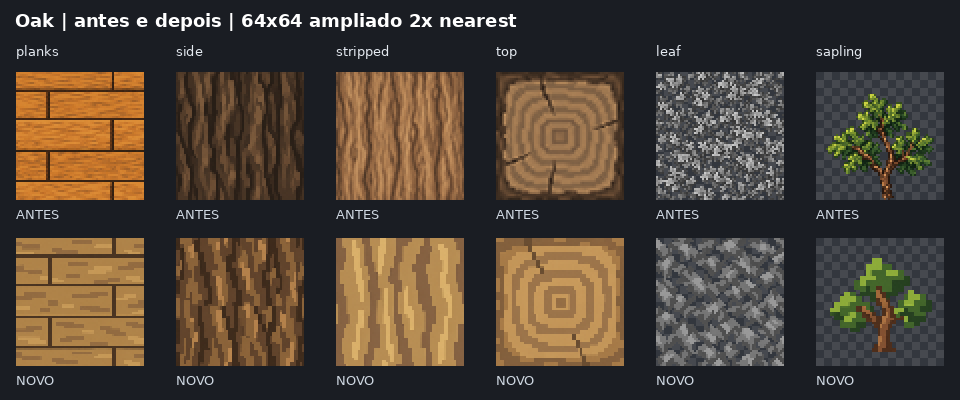

# Oak em pixel art simples — 13/10/2026

Primeiro conjunto de referência após a [auditoria de estilo](../texture-style-audit-2026-10-13/README.md): seis texturas Oak redesenhadas com grupos maiores de pixels, regiões foscas e detalhe interno contido. As planks têm juntas desencontradas; a casca e o stripped mantêm leitura vertical; o topo tem poucos anéis largos. A copa e a sapling usam formas mais simples.

## Arquivos finais

Todos têm 64×64 e ficam em `packs/default/resources/textures/blocks/trees/oak/`.

| Arquivo | Papel | Contrato |
| --- | --- | --- |
| `planks.png` | Tábuas | Opaco, juntas legíveis, sem moldura na repetição |
| `side.png` | Casca natural | Opaco, faixas verticais de casca |
| `stripped.png` | Madeira sem casca | Opaco, veios maiores e mais espaçados |
| `top.png` | Topo do tronco | Opaco, anéis em degraus e fissuras discretas |
| `leaf.png` | Folhas | Cutout, grayscale neutro para tint do bioma |
| `sapling.png` | Muda | Cutout, tronco e copa com cores próprias |

## Repetição e geração

Foram vistos os seis PNGs em 64×64 e com ampliação nearest. Os materiais foram revistos em mosaico 3×3: [planks](seams-planks.png), [casca](seams-side.png), [stripped](seams-stripped.png), [top](seams-top.png), [folhas](seams-leaf.png). A sapling é um sprite isolado com fundo transparente.

Foi usado **ImageGen embutido**, uma chamada por asset/iteração. [prompts.json](prompts.json) registra prompts exatos, referências, fontes selecionadas, hashes e normalização. A arte foi criada pelo gerador. A [paleta](palette-guide.png) e o [diagrama de juntas](plank-layout-guide.png) são referências técnicas.

Casca e stripped foram gerados como campos repetidos; o tile foi extraído do campo por crop e nearest, selecionando o trecho com continuidade nas bordas. As coordenadas estão registradas. Não foram pintados pixels para corrigir costuras. Demais assets receberam nearest para 64×64 e encoding PNG. Folhas foram neutralizadas para grayscale; leaf e sapling codificam como alpha binário a silhueta já definida pelo cutoff authored 0.5.

As métricas de borda em [validation.json](validation.json) são diagnósticos de contraste entre bordas; a revisão do mosaico verifica a ausência de linhas artificiais na repetição. Não representam uma afirmação de igualdade literal de todos os pixels das bordas.

## Escopo e validação

Este lote conclui **6 das 252 texturas** marcadas para mudança na auditoria. As outras dez famílias de árvore somam 61 arquivos a redesenhar. O inventário histórico permanece vinculado ao seu commit de origem.

Os 291 outros PNGs foram preservados por SHA-256. Nenhuma definição, shader, receita ou código de runtime foi alterado. O `leaf_oak` mantém tint do bioma; `sapling_oak` é um Object com `tint: none`, textura colorida e cutoff 0.5. O comportamento de crescimento existente foi preservado.

Revisão de arquitetura/engenharia: alteração de apresentação dentro do pack, sem nova lógica, estado, cache, API, dependência ou fluxo async. A validação local cobre dimensões, papel do alpha, grayscale, escopo por hashes e revisão visual. O jogo não foi executado localmente.
