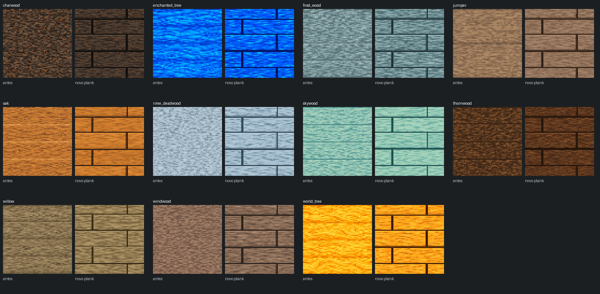

# Planks com leitura de tábuas

As onze texturas de planks foram refeitas visualmente. A versão anterior tinha veios corridos e divisões pouco legíveis. A nova composição mostra tábuas serradas horizontais, juntas estreitas escuras e emendas de topo desencontradas.

Cada família conserva a identidade da madeira: Charwood carbonizada; Enchanted azul royal/celeste; Frost Wood fria cinza-azulada; Juniper bege/taupe; Oak em tons de mel; Rime Deadwood azul-prateada; Skywood verde-água; Thornwood castanha escura; Willow oliva/taupe; Windwood castanha dessaturada; World Tree dourada.

Os arquivos finais são `packs/default/resources/textures/blocks/trees/<família>/planks.png`, nas famílias `log_charwood`, `enchanted_tree`, `log_frost_wood`, `juniper`, `oak`, `log_rime_deadwood`, `skywood`, `log_thornwood`, `willow`, `log_windwood` e `world_tree`.

Cada PNG final tem 64×64 pixels e cobertura opaca. As juntas horizontais ficam dentro do tile; a tábua atravessa as bordas superior e inferior, evitando uma moldura escura na repetição. As juntas verticais alternam de posição entre as fileiras.

## Repetição e recursos

Os mosaicos abaixo repetem os arquivos finais 3×3 nas duas direções, com nearest-neighbor:

- [Charwood, Enchanted, Frost Wood e Juniper](seams-1.png)
- [Oak, Rime Deadwood, Skywood e Thornwood](seams-2.png)
- [Willow, Windwood e World Tree](seams-3.png)

O trabalho altera somente a arte de planks e sua documentação. Os 286 outros PNGs foram conferidos por hash e preservados. As definições de blocos, receitas e código de runtime ficam preservados.

## Proveniência e validação

Foi usado o **ImageGen embutido**, uma chamada por textura, com ajustes pontuais no padrão de Oak antes de servir de referência. A arte vem do gerador. A normalização de produção consiste apenas em nearest-neighbor para 64×64 e PNG RGB opaco.

[prompts.json](prompts.json) contém os prompts exatos, referências e hashes. O [diagrama de construção](board-layout-guide.png) é uma referência geométrica precisa, não uma textura de madeira: a imagem final é criada pelo ImageGen. [validation.json](validation.json) registra dimensões, quatro juntas horizontais, emendas desencontradas e diagnósticos de borda. As medidas de borda auxiliam a revisão visual dos mosaicos.

A validação de recursos e localizações do pack e o build de WebUI são executados antes da publicação. A CI verifica o restante do projeto. Os previews mostram os PNGs finais e sua repetição; não são capturas do jogo.

Referência inicial dos materiais: `64e78558029b021fe0fbff565cf212d4e9e92fb6`.
