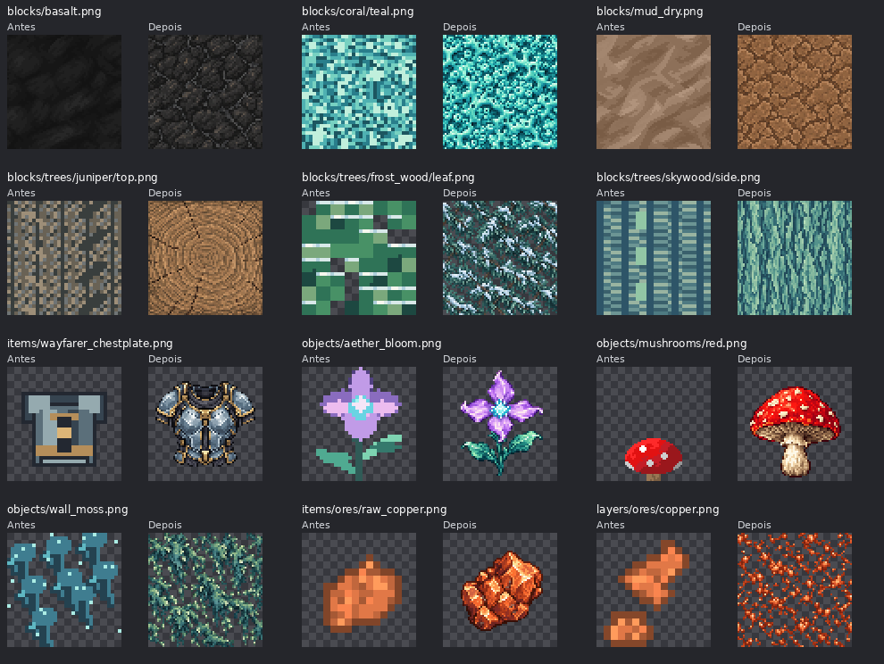

# Auditoria das texturas do pack default — 11/10/2026

Foram revisadas visualmente **279 imagens** de `packs/default/resources/textures/`. **154 arquivos foram substituídos**: 64 materiais de bloco, 68 objetos, 12 ícones de itens e 10 camadas. As outras 125 imagens foram mantidas e seus hashes conferidos.

Base integrada: `5719a12edfdd32cd649dd9ddd510ee49b7d20c6c`. A revisão inicial partiu de `b77b4d946efc4fee751af78ab7f815ddb8e6feb3`; as 16 texturas de minério adicionadas durante o trabalho também foram revisadas e refeitas.

## Problemas identificados

A avaliação considerou a função de cada imagem e o acabamento dos assets bons do próprio pack. Os arquivos escolhidos tinham listras e grades mecânicas, grupos de pixels muito grandes, silhuetas planas ou pouco detalhe de material. Alguns topos de árvore eram cópias da casca lateral. A quantidade de cores foi registrada como diagnóstico, sem usá-la isoladamente para decidir a qualidade.

As referências de acabamento incluem `blocks/dirt.png`, as faces e folhas de `blocks/trees/oak/`, `tools/hatchet-rustic.png` e `items/essence_verdra.png`. Máscaras funcionais, tint maps, slots de folhas vazios e layouts UV foram avaliados segundo sua função.

## Comparação

Comparativos de todas as 154 substituições: [Parte 1](comparison-1.png) · [Parte 2](comparison-2.png) · [Parte 3](comparison-3.png) · [Parte 4](comparison-4.png) · [Parte 5](comparison-5.png) · [Parte 6](comparison-6.png) · [Parte 7](comparison-7.png).

## Continuidade e contratos

**81 superfícies repetíveis** foram conferidas visualmente em mosaicos 3×3, nas duas direções. Os **73 sprites isolados** têm pelo menos dois pixels totalmente transparentes nas quatro margens. Os topos de tronco mostram anéis e fissuras de madeira exposta até as bordas, sem a moldura escura que formava uma grade. A margem do cogumelo rosa foi corrigida após a primeira checagem.

Mosaicos: [Parte 1](seam-proof-1.png) · [Parte 2](seam-proof-2.png) · [Parte 3](seam-proof-3.png) · [Parte 4](seam-proof-4.png).

A checagem numérica compara a diferença entre bordas opostas com a diferença média entre pixels vizinhos internos, em RGB pré-multiplicado por alpha. Razões acima de 1,8 exigem revisão. Nenhum arquivo final ficou sinalizado; esse indicador auxilia a inspeção visual e não substitui um teste de renderização no jogo. Resultados por arquivo: [seam-checks.json](seam-checks.json).

Todos os arquivos substituídos são PNG 64×64. Cutouts têm alpha binário; `blocks/ice.png` mantém alpha uniforme 159. `objects/grass.png` e `blocks/lamp.png` mantêm o mapa em tons de cinza para tint em runtime. As camadas `cliff_lichen` e `wall_moss` reutilizam exatamente as respectivas imagens de objeto. Os nomes e as quatro funções de material de árvore continuam válidos.

## Validação

- Integridade PNG, dimensões, alpha, tint, margens, caminhos e hashes: passou.
- Contrato de 11 famílias de árvores e referências autoradas do pack: passou.
- `node ui/scripts/check-localizations.mjs`: passou.
- `npm run build` e `npm run build-storybook`, em `ui/`: passaram.
- `git diff --check`: passou.
- Não foi adicionado metadata de Godot dentro do pack.
- Godot/.NET e renderização em jogo não foram executados: SDKs indisponíveis no ambiente. Os testes de paridade de telas não foram executados nesta alteração de assets.

A revisão de engenharia verificou que esta alteração permanece no conteúdo autorado do pack: sem mudanças de ownership, runtime, gameplay, formatos, modelos ou dependências de engine.

## Proveniência

As novas imagens foram criadas individualmente com o gerador integrado `image_gen.imagegen`, usando referências do próprio projeto. São 152 imagens distintas e duas camadas que reutilizam exatamente o respectivo objeto. A conversão de produção usa nearest-neighbor para 64×64, normalização do alpha de cutout e os contratos de tint descritos acima. O conjunto completo de prompts, referências e hashes finais está em [prompts.json](prompts.json).

## Inventário completo

| Pasta | Revisadas | Substituídas | Mantidas |
| --- | ---: | ---: | ---: |
| `blocks` | 122 | 64 | 58 |
| `creative_categories` | 10 | 0 | 10 |
| `creatures` | 14 | 0 | 14 |
| `destroy_stage` | 10 | 0 | 10 |
| `fluids` | 1 | 0 | 1 |
| `items` | 27 | 12 | 15 |
| `layers` | 11 | 10 | 1 |
| `objects` | 68 | 68 | 0 |
| `player` | 2 | 0 | 2 |
| `sky` | 2 | 0 | 2 |
| `tools` | 12 | 0 | 12 |

Cada caminho abaixo é relativo a `packs/default/resources/textures/`. Dados técnicos e hashes: [inventory.json](inventory.json).

| Arquivo | Decisão | Motivo |
| --- | --- | --- |
| `blocks/aether_crystal.png` | substituída | Listras, ruído regular ou superfície com pouco detalhe em comparação com os materiais acabados do pack. |
| `blocks/aether_crystal_core.png` | substituída | Listras, ruído regular ou superfície com pouco detalhe em comparação com os materiais acabados do pack. |
| `blocks/azure_crystal.png` | substituída | Listras, ruído regular ou superfície com pouco detalhe em comparação com os materiais acabados do pack. |
| `blocks/basalt.png` | substituída | Listras, ruído regular ou superfície com pouco detalhe em comparação com os materiais acabados do pack. |
| `blocks/basalt_bricks.png` | mantida | Arte legível e compatível com a função e a resolução; sem defeito claro na revisão visual. |
| `blocks/basalt_cobble.png` | mantida | Arte legível e compatível com a função e a resolução; sem defeito claro na revisão visual. |
| `blocks/basalt_column.png` | substituída | Listras, ruído regular ou superfície com pouco detalhe em comparação com os materiais acabados do pack. |
| `blocks/basalt_polished.png` | mantida | Arte legível e compatível com a função e a resolução; sem defeito claro na revisão visual. |
| `blocks/basalt_tiles.png` | mantida | Arte legível e compatível com a função e a resolução; sem defeito claro na revisão visual. |
| `blocks/bricks.png` | mantida | Arte legível e compatível com a função e a resolução; sem defeito claro na revisão visual. |
| `blocks/cactus/barrel/side.png` | substituída | Listras, ruído regular ou superfície com pouco detalhe em comparação com os materiais acabados do pack. |
| `blocks/cactus/barrel/top.png` | substituída | Listras, ruído regular ou superfície com pouco detalhe em comparação com os materiais acabados do pack. |
| `blocks/cactus/column/side.png` | substituída | Listras, ruído regular ou superfície com pouco detalhe em comparação com os materiais acabados do pack. |
| `blocks/cactus/column/top.png` | substituída | Listras, ruído regular ou superfície com pouco detalhe em comparação com os materiais acabados do pack. |
| `blocks/cactus/pad.png` | substituída | Listras, ruído regular ou superfície com pouco detalhe em comparação com os materiais acabados do pack. |
| `blocks/clay.png` | mantida | Arte legível e compatível com a função e a resolução; sem defeito claro na revisão visual. |
| `blocks/coral/blue.png` | substituída | Listras, ruído regular ou superfície com pouco detalhe em comparação com os materiais acabados do pack. |
| `blocks/coral/lime.png` | substituída | Listras, ruído regular ou superfície com pouco detalhe em comparação com os materiais acabados do pack. |
| `blocks/coral/orange.png` | substituída | Listras, ruído regular ou superfície com pouco detalhe em comparação com os materiais acabados do pack. |
| `blocks/coral/pink.png` | substituída | Listras, ruído regular ou superfície com pouco detalhe em comparação com os materiais acabados do pack. |
| `blocks/coral/teal.png` | substituída | Listras, ruído regular ou superfície com pouco detalhe em comparação com os materiais acabados do pack. |
| `blocks/coral/violet.png` | substituída | Listras, ruído regular ou superfície com pouco detalhe em comparação com os materiais acabados do pack. |
| `blocks/coral/yellow.png` | substituída | Listras, ruído regular ou superfície com pouco detalhe em comparação com os materiais acabados do pack. |
| `blocks/dirt.png` | mantida | Arte legível e compatível com a função e a resolução; sem defeito claro na revisão visual. |
| `blocks/fossil_bone.png` | substituída | Listras, ruído regular ou superfície com pouco detalhe em comparação com os materiais acabados do pack. |
| `blocks/glacial_ice_core.png` | substituída | Listras, ruído regular ou superfície com pouco detalhe em comparação com os materiais acabados do pack. |
| `blocks/glacial_rime_core.png` | substituída | Listras, ruído regular ou superfície com pouco detalhe em comparação com os materiais acabados do pack. |
| `blocks/glass.png` | mantida | Arte legível e compatível com a função e a resolução; sem defeito claro na revisão visual. |
| `blocks/grass/side.png` | mantida | Arte legível e compatível com a função e a resolução; sem defeito claro na revisão visual. |
| `blocks/grass/side_overlay.png` | mantida | Arte legível e compatível com a função e a resolução; sem defeito claro na revisão visual. |
| `blocks/grass/top.png` | mantida | Arte legível e compatível com a função e a resolução; sem defeito claro na revisão visual. |
| `blocks/gravel.png` | mantida | Arte legível e compatível com a função e a resolução; sem defeito claro na revisão visual. |
| `blocks/ice.png` | substituída | Listras, ruído regular ou superfície com pouco detalhe em comparação com os materiais acabados do pack. |
| `blocks/ice_bricks.png` | mantida | Arte legível e compatível com a função e a resolução; sem defeito claro na revisão visual. |
| `blocks/ice_polished.png` | mantida | Arte legível e compatível com a função e a resolução; sem defeito claro na revisão visual. |
| `blocks/ice_tiles.png` | mantida | Arte legível e compatível com a função e a resolução; sem defeito claro na revisão visual. |
| `blocks/kelp/frond.png` | substituída | Listras, ruído regular ou superfície com pouco detalhe em comparação com os materiais acabados do pack. |
| `blocks/kelp/stem.png` | substituída | Listras, ruído regular ou superfície com pouco detalhe em comparação com os materiais acabados do pack. |
| `blocks/lamp.png` | substituída | Listras, ruído regular ou superfície com pouco detalhe em comparação com os materiais acabados do pack. |
| `blocks/luminous_crystal_core.png` | substituída | Listras, ruído regular ou superfície com pouco detalhe em comparação com os materiais acabados do pack. |
| `blocks/mud.png` | substituída | Listras, ruído regular ou superfície com pouco detalhe em comparação com os materiais acabados do pack. |
| `blocks/mud_bricks.png` | mantida | Arte legível e compatível com a função e a resolução; sem defeito claro na revisão visual. |
| `blocks/mud_dry.png` | substituída | Listras, ruído regular ou superfície com pouco detalhe em comparação com os materiais acabados do pack. |
| `blocks/mud_polished.png` | mantida | Arte legível e compatível com a função e a resolução; sem defeito claro na revisão visual. |
| `blocks/mud_tiles.png` | mantida | Arte legível e compatível com a função e a resolução; sem defeito claro na revisão visual. |
| `blocks/mushrooms/glow/cap.png` | substituída | Listras, ruído regular ou superfície com pouco detalhe em comparação com os materiais acabados do pack. |
| `blocks/mushrooms/glow/stem.png` | substituída | Listras, ruído regular ou superfície com pouco detalhe em comparação com os materiais acabados do pack. |
| `blocks/mushrooms/luminous_giant/cap.png` | substituída | Listras, ruído regular ou superfície com pouco detalhe em comparação com os materiais acabados do pack. |
| `blocks/mushrooms/luminous_giant/stem.png` | substituída | Listras, ruído regular ou superfície com pouco detalhe em comparação com os materiais acabados do pack. |
| `blocks/mushrooms/marsh_giant/cap.png` | substituída | Listras, ruído regular ou superfície com pouco detalhe em comparação com os materiais acabados do pack. |
| `blocks/mushrooms/marsh_giant/stem.png` | substituída | Listras, ruído regular ou superfície com pouco detalhe em comparação com os materiais acabados do pack. |
| `blocks/portals/umbral.png` | mantida | Arte legível e compatível com a função e a resolução; sem defeito claro na revisão visual. |
| `blocks/sand.png` | mantida | Arte legível e compatível com a função e a resolução; sem defeito claro na revisão visual. |
| `blocks/sandstone.png` | mantida | Arte legível e compatível com a função e a resolução; sem defeito claro na revisão visual. |
| `blocks/sandstone_bricks.png` | mantida | Arte legível e compatível com a função e a resolução; sem defeito claro na revisão visual. |
| `blocks/sandstone_polished.png` | mantida | Arte legível e compatível com a função e a resolução; sem defeito claro na revisão visual. |
| `blocks/sandstone_tiles.png` | mantida | Arte legível e compatível com a função e a resolução; sem defeito claro na revisão visual. |
| `blocks/snow.png` | substituída | Listras, ruído regular ou superfície com pouco detalhe em comparação com os materiais acabados do pack. |
| `blocks/snow_bricks.png` | mantida | Arte legível e compatível com a função e a resolução; sem defeito claro na revisão visual. |
| `blocks/snow_polished.png` | mantida | Arte legível e compatível com a função e a resolução; sem defeito claro na revisão visual. |
| `blocks/snow_tiles.png` | mantida | Arte legível e compatível com a função e a resolução; sem defeito claro na revisão visual. |
| `blocks/stone.png` | substituída | Listras, ruído regular ou superfície com pouco detalhe em comparação com os materiais acabados do pack. |
| `blocks/stone_bricks.png` | mantida | Arte legível e compatível com a função e a resolução; sem defeito claro na revisão visual. |
| `blocks/stone_cobble.png` | mantida | Arte legível e compatível com a função e a resolução; sem defeito claro na revisão visual. |
| `blocks/stone_polished.png` | mantida | Arte legível e compatível com a função e a resolução; sem defeito claro na revisão visual. |
| `blocks/stone_tiles.png` | mantida | Arte legível e compatível com a função e a resolução; sem defeito claro na revisão visual. |
| `blocks/storage_box/bottom.png` | mantida | Arte legível e compatível com a função e a resolução; sem defeito claro na revisão visual. |
| `blocks/storage_box/front.png` | mantida | Arte legível e compatível com a função e a resolução; sem defeito claro na revisão visual. |
| `blocks/storage_box/side.png` | mantida | Arte legível e compatível com a função e a resolução; sem defeito claro na revisão visual. |
| `blocks/storage_box/top.png` | mantida | Arte legível e compatível com a função e a resolução; sem defeito claro na revisão visual. |
| `blocks/sulfur_crystal.png` | substituída | Listras, ruído regular ou superfície com pouco detalhe em comparação com os materiais acabados do pack. |
| `blocks/terracotta.png` | mantida | Arte legível e compatível com a função e a resolução; sem defeito claro na revisão visual. |
| `blocks/trees/charwood/leaf.png` | substituída | Casca/folhagem com padrão mecânico, anéis grosseiros ou topo igual à lateral; falta de detalhe e distinção entre as faces. |
| `blocks/trees/charwood/side.png` | substituída | Casca/folhagem com padrão mecânico, anéis grosseiros ou topo igual à lateral; falta de detalhe e distinção entre as faces. |
| `blocks/trees/charwood/stripped.png` | substituída | Casca/folhagem com padrão mecânico, anéis grosseiros ou topo igual à lateral; falta de detalhe e distinção entre as faces. |
| `blocks/trees/charwood/top.png` | substituída | Casca/folhagem com padrão mecânico, anéis grosseiros ou topo igual à lateral; falta de detalhe e distinção entre as faces. |
| `blocks/trees/enchanted_tree/leaf.png` | mantida | Arte legível e compatível com a função e a resolução; sem defeito claro na revisão visual. |
| `blocks/trees/enchanted_tree/planks.png` | mantida | Arte legível e compatível com a função e a resolução; sem defeito claro na revisão visual. |
| `blocks/trees/enchanted_tree/side.png` | mantida | Arte legível e compatível com a função e a resolução; sem defeito claro na revisão visual. |
| `blocks/trees/enchanted_tree/stripped.png` | mantida | Arte legível e compatível com a função e a resolução; sem defeito claro na revisão visual. |
| `blocks/trees/enchanted_tree/top.png` | mantida | Arte legível e compatível com a função e a resolução; sem defeito claro na revisão visual. |
| `blocks/trees/frost_wood/leaf.png` | substituída | Casca/folhagem com padrão mecânico, anéis grosseiros ou topo igual à lateral; falta de detalhe e distinção entre as faces. |
| `blocks/trees/frost_wood/leaf_arctic.png` | substituída | Casca/folhagem com padrão mecânico, anéis grosseiros ou topo igual à lateral; falta de detalhe e distinção entre as faces. |
| `blocks/trees/frost_wood/side.png` | substituída | Casca/folhagem com padrão mecânico, anéis grosseiros ou topo igual à lateral; falta de detalhe e distinção entre as faces. |
| `blocks/trees/frost_wood/stripped.png` | substituída | Casca/folhagem com padrão mecânico, anéis grosseiros ou topo igual à lateral; falta de detalhe e distinção entre as faces. |
| `blocks/trees/frost_wood/top.png` | substituída | Casca/folhagem com padrão mecânico, anéis grosseiros ou topo igual à lateral; falta de detalhe e distinção entre as faces. |
| `blocks/trees/juniper/leaf.png` | substituída | Casca/folhagem com padrão mecânico, anéis grosseiros ou topo igual à lateral; falta de detalhe e distinção entre as faces. |
| `blocks/trees/juniper/side.png` | substituída | Casca/folhagem com padrão mecânico, anéis grosseiros ou topo igual à lateral; falta de detalhe e distinção entre as faces. |
| `blocks/trees/juniper/stripped.png` | substituída | Casca/folhagem com padrão mecânico, anéis grosseiros ou topo igual à lateral; falta de detalhe e distinção entre as faces. |
| `blocks/trees/juniper/top.png` | substituída | Casca/folhagem com padrão mecânico, anéis grosseiros ou topo igual à lateral; falta de detalhe e distinção entre as faces. |
| `blocks/trees/oak/leaf.png` | mantida | Arte legível e compatível com a função e a resolução; sem defeito claro na revisão visual. |
| `blocks/trees/oak/planks.png` | mantida | Arte legível e compatível com a função e a resolução; sem defeito claro na revisão visual. |
| `blocks/trees/oak/side.png` | mantida | Arte legível e compatível com a função e a resolução; sem defeito claro na revisão visual. |
| `blocks/trees/oak/stripped.png` | mantida | Arte legível e compatível com a função e a resolução; sem defeito claro na revisão visual. |
| `blocks/trees/oak/top.png` | mantida | Arte legível e compatível com a função e a resolução; sem defeito claro na revisão visual. |
| `blocks/trees/rime_deadwood/leaf.png` | mantida | Slot transparente intencional de árvore sem folhas, exigido pelo contrato de materiais. |
| `blocks/trees/rime_deadwood/side.png` | substituída | Casca/folhagem com padrão mecânico, anéis grosseiros ou topo igual à lateral; falta de detalhe e distinção entre as faces. |
| `blocks/trees/rime_deadwood/stripped.png` | substituída | Casca/folhagem com padrão mecânico, anéis grosseiros ou topo igual à lateral; falta de detalhe e distinção entre as faces. |
| `blocks/trees/rime_deadwood/top.png` | substituída | Casca/folhagem com padrão mecânico, anéis grosseiros ou topo igual à lateral; falta de detalhe e distinção entre as faces. |
| `blocks/trees/skywood/leaf.png` | substituída | Casca/folhagem com padrão mecânico, anéis grosseiros ou topo igual à lateral; falta de detalhe e distinção entre as faces. |
| `blocks/trees/skywood/side.png` | substituída | Casca/folhagem com padrão mecânico, anéis grosseiros ou topo igual à lateral; falta de detalhe e distinção entre as faces. |
| `blocks/trees/skywood/stripped.png` | substituída | Casca/folhagem com padrão mecânico, anéis grosseiros ou topo igual à lateral; falta de detalhe e distinção entre as faces. |
| `blocks/trees/skywood/top.png` | substituída | Casca/folhagem com padrão mecânico, anéis grosseiros ou topo igual à lateral; falta de detalhe e distinção entre as faces. |
| `blocks/trees/thornwood/leaf.png` | mantida | Slot transparente intencional de árvore sem folhas, exigido pelo contrato de materiais. |
| `blocks/trees/thornwood/side.png` | substituída | Casca/folhagem com padrão mecânico, anéis grosseiros ou topo igual à lateral; falta de detalhe e distinção entre as faces. |
| `blocks/trees/thornwood/stripped.png` | substituída | Casca/folhagem com padrão mecânico, anéis grosseiros ou topo igual à lateral; falta de detalhe e distinção entre as faces. |
| `blocks/trees/thornwood/top.png` | substituída | Casca/folhagem com padrão mecânico, anéis grosseiros ou topo igual à lateral; falta de detalhe e distinção entre as faces. |
| `blocks/trees/willow/leaf.png` | mantida | Arte legível e compatível com a função e a resolução; sem defeito claro na revisão visual. |
| `blocks/trees/willow/planks.png` | mantida | Arte legível e compatível com a função e a resolução; sem defeito claro na revisão visual. |
| `blocks/trees/willow/side.png` | mantida | Arte legível e compatível com a função e a resolução; sem defeito claro na revisão visual. |
| `blocks/trees/willow/stripped.png` | mantida | Arte legível e compatível com a função e a resolução; sem defeito claro na revisão visual. |
| `blocks/trees/willow/top.png` | mantida | Arte legível e compatível com a função e a resolução; sem defeito claro na revisão visual. |
| `blocks/trees/windwood/leaf.png` | substituída | Casca/folhagem com padrão mecânico, anéis grosseiros ou topo igual à lateral; falta de detalhe e distinção entre as faces. |
| `blocks/trees/windwood/side.png` | substituída | Casca/folhagem com padrão mecânico, anéis grosseiros ou topo igual à lateral; falta de detalhe e distinção entre as faces. |
| `blocks/trees/windwood/stripped.png` | substituída | Casca/folhagem com padrão mecânico, anéis grosseiros ou topo igual à lateral; falta de detalhe e distinção entre as faces. |
| `blocks/trees/windwood/top.png` | substituída | Casca/folhagem com padrão mecânico, anéis grosseiros ou topo igual à lateral; falta de detalhe e distinção entre as faces. |
| `blocks/trees/world_tree/leaf.png` | mantida | Arte legível e compatível com a função e a resolução; sem defeito claro na revisão visual. |
| `blocks/trees/world_tree/planks.png` | mantida | Arte legível e compatível com a função e a resolução; sem defeito claro na revisão visual. |
| `blocks/trees/world_tree/side.png` | mantida | Arte legível e compatível com a função e a resolução; sem defeito claro na revisão visual. |
| `blocks/trees/world_tree/stripped.png` | mantida | Arte legível e compatível com a função e a resolução; sem defeito claro na revisão visual. |
| `blocks/trees/world_tree/top.png` | mantida | Arte legível e compatível com a função e a resolução; sem defeito claro na revisão visual. |
| `blocks/volcanic_glass.png` | substituída | Listras, ruído regular ou superfície com pouco detalhe em comparação com os materiais acabados do pack. |
| `creative_categories/crafted_blocks.png` | mantida | Arte legível e compatível com a função e a resolução; sem defeito claro na revisão visual. |
| `creative_categories/crafting_materials.png` | mantida | Arte legível e compatível com a função e a resolução; sem defeito claro na revisão visual. |
| `creative_categories/creative_tools.png` | mantida | Arte legível e compatível com a função e a resolução; sem defeito claro na revisão visual. |
| `creative_categories/everything.png` | mantida | Arte legível e compatível com a função e a resolução; sem defeito claro na revisão visual. |
| `creative_categories/foliage.png` | mantida | Arte legível e compatível com a função e a resolução; sem defeito claro na revisão visual. |
| `creative_categories/light_sources.png` | mantida | Arte legível e compatível com a função e a resolução; sem defeito claro na revisão visual. |
| `creative_categories/natural_blocks.png` | mantida | Arte legível e compatível com a função e a resolução; sem defeito claro na revisão visual. |
| `creative_categories/stone_blocks.png` | mantida | Arte legível e compatível com a função e a resolução; sem defeito claro na revisão visual. |
| `creative_categories/tools.png` | mantida | Arte legível e compatível com a função e a resolução; sem defeito claro na revisão visual. |
| `creative_categories/wooden_blocks.png` | mantida | Arte legível e compatível com a função e a resolução; sem defeito claro na revisão visual. |
| `creatures/slime/face.png` | mantida | Máscara funcional, progressiva ou material neutro para tint; paleta limitada intencional. |
| `creatures/slime/shell.png` | mantida | Máscara funcional, progressiva ou material neutro para tint; paleta limitada intencional. |
| `creatures/slime_anemo/face.png` | mantida | Arte legível e compatível com a função e a resolução; sem defeito claro na revisão visual. |
| `creatures/slime_cryo/face.png` | mantida | Arte legível e compatível com a função e a resolução; sem defeito claro na revisão visual. |
| `creatures/slime_dendro/face.png` | mantida | Arte legível e compatível com a função e a resolução; sem defeito claro na revisão visual. |
| `creatures/slime_electro/face.png` | mantida | Arte legível e compatível com a função e a resolução; sem defeito claro na revisão visual. |
| `creatures/slime_geo/face.png` | mantida | Arte legível e compatível com a função e a resolução; sem defeito claro na revisão visual. |
| `creatures/slime_hydro/face.png` | mantida | Arte legível e compatível com a função e a resolução; sem defeito claro na revisão visual. |
| `creatures/slime_legacy/core.png` | mantida | Máscara funcional, progressiva ou material neutro para tint; paleta limitada intencional. |
| `creatures/slime_legacy/face.png` | mantida | Máscara funcional, progressiva ou material neutro para tint; paleta limitada intencional. |
| `creatures/slime_legacy/shell.png` | mantida | Máscara funcional, progressiva ou material neutro para tint; paleta limitada intencional. |
| `creatures/slime_lumen/face.png` | mantida | Arte legível e compatível com a função e a resolução; sem defeito claro na revisão visual. |
| `creatures/slime_pyro/face.png` | mantida | Arte legível e compatível com a função e a resolução; sem defeito claro na revisão visual. |
| `creatures/slime_tenebra/face.png` | mantida | Arte legível e compatível com a função e a resolução; sem defeito claro na revisão visual. |
| `destroy_stage/destroy_stage_0.png` | mantida | Máscara funcional, progressiva ou material neutro para tint; paleta limitada intencional. |
| `destroy_stage/destroy_stage_1.png` | mantida | Máscara funcional, progressiva ou material neutro para tint; paleta limitada intencional. |
| `destroy_stage/destroy_stage_2.png` | mantida | Máscara funcional, progressiva ou material neutro para tint; paleta limitada intencional. |
| `destroy_stage/destroy_stage_3.png` | mantida | Máscara funcional, progressiva ou material neutro para tint; paleta limitada intencional. |
| `destroy_stage/destroy_stage_4.png` | mantida | Máscara funcional, progressiva ou material neutro para tint; paleta limitada intencional. |
| `destroy_stage/destroy_stage_5.png` | mantida | Máscara funcional, progressiva ou material neutro para tint; paleta limitada intencional. |
| `destroy_stage/destroy_stage_6.png` | mantida | Máscara funcional, progressiva ou material neutro para tint; paleta limitada intencional. |
| `destroy_stage/destroy_stage_7.png` | mantida | Máscara funcional, progressiva ou material neutro para tint; paleta limitada intencional. |
| `destroy_stage/destroy_stage_8.png` | mantida | Máscara funcional, progressiva ou material neutro para tint; paleta limitada intencional. |
| `destroy_stage/destroy_stage_9.png` | mantida | Máscara funcional, progressiva ou material neutro para tint; paleta limitada intencional. |
| `fluids/water.png` | mantida | Arte legível e compatível com a função e a resolução; sem defeito claro na revisão visual. |
| `items/dimensional_slicer.png` | mantida | Arte legível e compatível com a função e a resolução; sem defeito claro na revisão visual. |
| `items/dimensional_slicer_umbral.png` | mantida | Arte legível e compatível com a função e a resolução; sem defeito claro na revisão visual. |
| `items/essence_aqua.png` | mantida | Arte legível e compatível com a função e a resolução; sem defeito claro na revisão visual. |
| `items/essence_kyra.png` | mantida | Arte legível e compatível com a função e a resolução; sem defeito claro na revisão visual. |
| `items/essence_luma.png` | mantida | Arte legível e compatível com a função e a resolução; sem defeito claro na revisão visual. |
| `items/essence_nyxa.png` | mantida | Arte legível e compatível com a função e a resolução; sem defeito claro na revisão visual. |
| `items/essence_pyra.png` | mantida | Arte legível e compatível com a função e a resolução; sem defeito claro na revisão visual. |
| `items/essence_terra.png` | mantida | Arte legível e compatível com a função e a resolução; sem defeito claro na revisão visual. |
| `items/essence_vaela.png` | mantida | Arte legível e compatível com a função e a resolução; sem defeito claro na revisão visual. |
| `items/essence_verdra.png` | mantida | Arte legível e compatível com a função e a resolução; sem defeito claro na revisão visual. |
| `items/essence_voltra.png` | mantida | Arte legível e compatível com a função e a resolução; sem defeito claro na revisão visual. |
| `items/ores/raw_copper.png` | substituída | Placeholder de minério com seis cores e grupos de pixels ampliados, sem o acabamento dos ícones e overlays do pack. |
| `items/ores/raw_gold.png` | substituída | Placeholder de minério com seis cores e grupos de pixels ampliados, sem o acabamento dos ícones e overlays do pack. |
| `items/ores/raw_iron.png` | substituída | Placeholder de minério com seis cores e grupos de pixels ampliados, sem o acabamento dos ícones e overlays do pack. |
| `items/ores/raw_lead.png` | substituída | Placeholder de minério com seis cores e grupos de pixels ampliados, sem o acabamento dos ícones e overlays do pack. |
| `items/ores/raw_nickel.png` | substituída | Placeholder de minério com seis cores e grupos de pixels ampliados, sem o acabamento dos ícones e overlays do pack. |
| `items/ores/raw_silver.png` | substituída | Placeholder de minério com seis cores e grupos de pixels ampliados, sem o acabamento dos ícones e overlays do pack. |
| `items/ores/raw_tin.png` | substituída | Placeholder de minério com seis cores e grupos de pixels ampliados, sem o acabamento dos ícones e overlays do pack. |
| `items/ores/raw_zinc.png` | substituída | Placeholder de minério com seis cores e grupos de pixels ampliados, sem o acabamento dos ícones e overlays do pack. |
| `items/pebble.png` | mantida | Arte legível e compatível com a função e a resolução; sem defeito claro na revisão visual. |
| `items/plant-fiber.png` | mantida | Arte legível e compatível com a função e a resolução; sem defeito claro na revisão visual. |
| `items/spore-enchanted-forest.png` | mantida | Arte legível e compatível com a função e a resolução; sem defeito claro na revisão visual. |
| `items/stick.png` | mantida | Arte legível e compatível com a função e a resolução; sem defeito claro na revisão visual. |
| `items/wayfarer_boots.png` | substituída | Equipamento com formas de placeholder, sem construção legível nem o volume e o acabamento dos ícones de ferramentas. |
| `items/wayfarer_chestplate.png` | substituída | Equipamento com formas de placeholder, sem construção legível nem o volume e o acabamento dos ícones de ferramentas. |
| `items/wayfarer_helmet.png` | substituída | Equipamento com formas de placeholder, sem construção legível nem o volume e o acabamento dos ícones de ferramentas. |
| `items/wayfarer_leggings.png` | substituída | Equipamento com formas de placeholder, sem construção legível nem o volume e o acabamento dos ícones de ferramentas. |
| `layers/cliff_lichen.png` | substituída | Listras, ruído regular ou superfície com pouco detalhe em comparação com os materiais acabados do pack. |
| `layers/moss.png` | mantida | Arte legível e compatível com a função e a resolução; sem defeito claro na revisão visual. |
| `layers/ores/copper.png` | substituída | Placeholder de minério com seis cores e grupos de pixels ampliados, sem o acabamento dos ícones e overlays do pack. |
| `layers/ores/gold.png` | substituída | Placeholder de minério com seis cores e grupos de pixels ampliados, sem o acabamento dos ícones e overlays do pack. |
| `layers/ores/iron.png` | substituída | Placeholder de minério com seis cores e grupos de pixels ampliados, sem o acabamento dos ícones e overlays do pack. |
| `layers/ores/lead.png` | substituída | Placeholder de minério com seis cores e grupos de pixels ampliados, sem o acabamento dos ícones e overlays do pack. |
| `layers/ores/nickel.png` | substituída | Placeholder de minério com seis cores e grupos de pixels ampliados, sem o acabamento dos ícones e overlays do pack. |
| `layers/ores/silver.png` | substituída | Placeholder de minério com seis cores e grupos de pixels ampliados, sem o acabamento dos ícones e overlays do pack. |
| `layers/ores/tin.png` | substituída | Placeholder de minério com seis cores e grupos de pixels ampliados, sem o acabamento dos ícones e overlays do pack. |
| `layers/ores/zinc.png` | substituída | Placeholder de minério com seis cores e grupos de pixels ampliados, sem o acabamento dos ícones e overlays do pack. |
| `layers/wall_moss.png` | substituída | Listras, ruído regular ou superfície com pouco detalhe em comparação com os materiais acabados do pack. |
| `objects/aether_bloom.png` | substituída | Silhueta plana, grupos de pixels muito grandes e pouco sombreamento em comparação com os assets acabados do pack. |
| `objects/aether_vines.png` | substituída | Silhueta plana, grupos de pixels muito grandes e pouco sombreamento em comparação com os assets acabados do pack. |
| `objects/alpine_edelweiss.png` | substituída | Silhueta plana, grupos de pixels muito grandes e pouco sombreamento em comparação com os assets acabados do pack. |
| `objects/alpine_sedge.png` | substituída | Silhueta plana, grupos de pixels muito grandes e pouco sombreamento em comparação com os assets acabados do pack. |
| `objects/ash_thorn.png` | substituída | Silhueta plana, grupos de pixels muito grandes e pouco sombreamento em comparação com os assets acabados do pack. |
| `objects/bleached_roots.png` | substituída | Silhueta plana, grupos de pixels muito grandes e pouco sombreamento em comparação com os assets acabados do pack. |
| `objects/bone_scatter.png` | substituída | Silhueta plana, grupos de pixels muito grandes e pouco sombreamento em comparação com os assets acabados do pack. |
| `objects/brittle_tuft.png` | substituída | Silhueta plana, grupos de pixels muito grandes e pouco sombreamento em comparação com os assets acabados do pack. |
| `objects/bulrush.png` | substituída | Silhueta plana, grupos de pixels muito grandes e pouco sombreamento em comparação com os assets acabados do pack. |
| `objects/cactus/flower_pink.png` | substituída | Silhueta plana, grupos de pixels muito grandes e pouco sombreamento em comparação com os assets acabados do pack. |
| `objects/cactus/flower_yellow.png` | substituída | Silhueta plana, grupos de pixels muito grandes e pouco sombreamento em comparação com os assets acabados do pack. |
| `objects/cattail.png` | substituída | Silhueta plana, grupos de pixels muito grandes e pouco sombreamento em comparação com os assets acabados do pack. |
| `objects/cinder_bloom.png` | substituída | Silhueta plana, grupos de pixels muito grandes e pouco sombreamento em comparação com os assets acabados do pack. |
| `objects/cliff_lichen.png` | substituída | Silhueta plana, grupos de pixels muito grandes e pouco sombreamento em comparação com os assets acabados do pack. |
| `objects/cliff_rosette.png` | substituída | Silhueta plana, grupos de pixels muito grandes e pouco sombreamento em comparação com os assets acabados do pack. |
| `objects/cloud_reed.png` | substituída | Silhueta plana, grupos de pixels muito grandes e pouco sombreamento em comparação com os assets acabados do pack. |
| `objects/clover.png` | substituída | Silhueta plana, grupos de pixels muito grandes e pouco sombreamento em comparação com os assets acabados do pack. |
| `objects/daisy.png` | substituída | Silhueta plana, grupos de pixels muito grandes e pouco sombreamento em comparação com os assets acabados do pack. |
| `objects/dead_thistle.png` | substituída | Silhueta plana, grupos de pixels muito grandes e pouco sombreamento em comparação com os assets acabados do pack. |
| `objects/dry_lichen.png` | substituída | Silhueta plana, grupos de pixels muito grandes e pouco sombreamento em comparação com os assets acabados do pack. |
| `objects/dry_tuft.png` | substituída | Silhueta plana, grupos de pixels muito grandes e pouco sombreamento em comparação com os assets acabados do pack. |
| `objects/dune_grass.png` | substituída | Silhueta plana, grupos de pixels muito grandes e pouco sombreamento em comparação com os assets acabados do pack. |
| `objects/exposed_roots.png` | substituída | Silhueta plana, grupos de pixels muito grandes e pouco sombreamento em comparação com os assets acabados do pack. |
| `objects/frost_lichen.png` | substituída | Silhueta plana, grupos de pixels muito grandes e pouco sombreamento em comparação com os assets acabados do pack. |
| `objects/frost_shrub.png` | substituída | Silhueta plana, grupos de pixels muito grandes e pouco sombreamento em comparação com os assets acabados do pack. |
| `objects/glow_fern.png` | substituída | Silhueta plana, grupos de pixels muito grandes e pouco sombreamento em comparação com os assets acabados do pack. |
| `objects/glow_pod.png` | substituída | Silhueta plana, grupos de pixels muito grandes e pouco sombreamento em comparação com os assets acabados do pack. |
| `objects/grass.png` | substituída | Silhueta plana, grupos de pixels muito grandes e pouco sombreamento em comparação com os assets acabados do pack. |
| `objects/hanging_moss.png` | substituída | Silhueta plana, grupos de pixels muito grandes e pouco sombreamento em comparação com os assets acabados do pack. |
| `objects/hanging_roots.png` | substituída | Silhueta plana, grupos de pixels muito grandes e pouco sombreamento em comparação com os assets acabados do pack. |
| `objects/iris.png` | substituída | Silhueta plana, grupos de pixels muito grandes e pouco sombreamento em comparação com os assets acabados do pack. |
| `objects/kelp.png` | substituída | Silhueta plana, grupos de pixels muito grandes e pouco sombreamento em comparação com os assets acabados do pack. |
| `objects/lily_pad.png` | substituída | Silhueta plana, grupos de pixels muito grandes e pouco sombreamento em comparação com os assets acabados do pack. |
| `objects/marsh_fern.png` | substituída | Silhueta plana, grupos de pixels muito grandes e pouco sombreamento em comparação com os assets acabados do pack. |
| `objects/marsh_orchid.png` | substituída | Silhueta plana, grupos de pixels muito grandes e pouco sombreamento em comparação com os assets acabados do pack. |
| `objects/meadow_seedheads.png` | substituída | Silhueta plana, grupos de pixels muito grandes e pouco sombreamento em comparação com os assets acabados do pack. |
| `objects/mushrooms/blue.png` | substituída | Silhueta plana, grupos de pixels muito grandes e pouco sombreamento em comparação com os assets acabados do pack. |
| `objects/mushrooms/brown.png` | substituída | Silhueta plana, grupos de pixels muito grandes e pouco sombreamento em comparação com os assets acabados do pack. |
| `objects/mushrooms/glowcap.png` | substituída | Silhueta plana, grupos de pixels muito grandes e pouco sombreamento em comparação com os assets acabados do pack. |
| `objects/mushrooms/green.png` | substituída | Silhueta plana, grupos de pixels muito grandes e pouco sombreamento em comparação com os assets acabados do pack. |
| `objects/mushrooms/pink.png` | substituída | Silhueta plana, grupos de pixels muito grandes e pouco sombreamento em comparação com os assets acabados do pack. |
| `objects/mushrooms/purple.png` | substituída | Silhueta plana, grupos de pixels muito grandes e pouco sombreamento em comparação com os assets acabados do pack. |
| `objects/mushrooms/red.png` | substituída | Silhueta plana, grupos de pixels muito grandes e pouco sombreamento em comparação com os assets acabados do pack. |
| `objects/mushrooms/yellow.png` | substituída | Silhueta plana, grupos de pixels muito grandes e pouco sombreamento em comparação com os assets acabados do pack. |
| `objects/pass_grass.png` | substituída | Silhueta plana, grupos de pixels muito grandes e pouco sombreamento em comparação com os assets acabados do pack. |
| `objects/pink_bloom.png` | substituída | Silhueta plana, grupos de pixels muito grandes e pouco sombreamento em comparação com os assets acabados do pack. |
| `objects/purple_aster.png` | substituída | Silhueta plana, grupos de pixels muito grandes e pouco sombreamento em comparação com os assets acabados do pack. |
| `objects/rock_lichen.png` | substituída | Silhueta plana, grupos de pixels muito grandes e pouco sombreamento em comparação com os assets acabados do pack. |
| `objects/sagebrush.png` | substituída | Silhueta plana, grupos de pixels muito grandes e pouco sombreamento em comparação com os assets acabados do pack. |
| `objects/saxifrage.png` | substituída | Silhueta plana, grupos de pixels muito grandes e pouco sombreamento em comparação com os assets acabados do pack. |
| `objects/scree_lichen.png` | substituída | Silhueta plana, grupos de pixels muito grandes e pouco sombreamento em comparação com os assets acabados do pack. |
| `objects/sea_anemone.png` | substituída | Silhueta plana, grupos de pixels muito grandes e pouco sombreamento em comparação com os assets acabados do pack. |
| `objects/seagrass.png` | substituída | Silhueta plana, grupos de pixels muito grandes e pouco sombreamento em comparação com os assets acabados do pack. |
| `objects/seashell.png` | substituída | Silhueta plana, grupos de pixels muito grandes e pouco sombreamento em comparação com os assets acabados do pack. |
| `objects/shelf_fungus.png` | substituída | Silhueta plana, grupos de pixels muito grandes e pouco sombreamento em comparação com os assets acabados do pack. |
| `objects/soot_lichen.png` | substituída | Silhueta plana, grupos de pixels muito grandes e pouco sombreamento em comparação com os assets acabados do pack. |
| `objects/starfish.png` | substituída | Silhueta plana, grupos de pixels muito grandes e pouco sombreamento em comparação com os assets acabados do pack. |
| `objects/starflower.png` | substituída | Silhueta plana, grupos de pixels muito grandes e pouco sombreamento em comparação com os assets acabados do pack. |
| `objects/stonecrop.png` | substituída | Silhueta plana, grupos de pixels muito grandes e pouco sombreamento em comparação com os assets acabados do pack. |
| `objects/tall_grass.png` | substituída | Silhueta plana, grupos de pixels muito grandes e pouco sombreamento em comparação com os assets acabados do pack. |
| `objects/thorn_rosette.png` | substituída | Silhueta plana, grupos de pixels muito grandes e pouco sombreamento em comparação com os assets acabados do pack. |
| `objects/thornbush.png` | substituída | Silhueta plana, grupos de pixels muito grandes e pouco sombreamento em comparação com os assets acabados do pack. |
| `objects/violet_fern.png` | substituída | Silhueta plana, grupos de pixels muito grandes e pouco sombreamento em comparação com os assets acabados do pack. |
| `objects/wall_moss.png` | substituída | Silhueta plana, grupos de pixels muito grandes e pouco sombreamento em comparação com os assets acabados do pack. |
| `objects/wall_shelf_fungus.png` | substituída | Silhueta plana, grupos de pixels muito grandes e pouco sombreamento em comparação com os assets acabados do pack. |
| `objects/wildflower_blue.png` | substituída | Silhueta plana, grupos de pixels muito grandes e pouco sombreamento em comparação com os assets acabados do pack. |
| `objects/wildflower_yellow.png` | substituída | Silhueta plana, grupos de pixels muito grandes e pouco sombreamento em comparação com os assets acabados do pack. |
| `objects/yucca.png` | substituída | Silhueta plana, grupos de pixels muito grandes e pouco sombreamento em comparação com os assets acabados do pack. |
| `player/256.png` | mantida | Skin com layout UV próprio e identidade do personagem; sem defeito claro que justifique alterar o atlas. |
| `player/64.png` | mantida | Skin com layout UV próprio e identidade do personagem; sem defeito claro que justifique alterar o atlas. |
| `sky/moon.png` | mantida | Arte legível e compatível com a função e a resolução; sem defeito claro na revisão visual. |
| `sky/sun.png` | mantida | Arte legível e compatível com a função e a resolução; sem defeito claro na revisão visual. |
| `tools/architects-compass.png` | mantida | Arte legível e compatível com a função e a resolução; sem defeito claro na revisão visual. |
| `tools/artisans-kit.png` | mantida | Arte legível e compatível com a função e a resolução; sem defeito claro na revisão visual. |
| `tools/brush-tint.png` | mantida | Máscara funcional, progressiva ou material neutro para tint; paleta limitada intencional. |
| `tools/brush.png` | mantida | Arte legível e compatível com a função e a resolução; sem defeito claro na revisão visual. |
| `tools/carpenters-axe-rustic.png` | mantida | Arte legível e compatível com a função e a resolução; sem defeito claro na revisão visual. |
| `tools/hatchet-rustic.png` | mantida | Arte legível e compatível com a função e a resolução; sem defeito claro na revisão visual. |
| `tools/iron_bucket_empty.png` | mantida | Arte legível e compatível com a função e a resolução; sem defeito claro na revisão visual. |
| `tools/iron_bucket_lava.png` | mantida | Arte legível e compatível com a função e a resolução; sem defeito claro na revisão visual. |
| `tools/iron_bucket_water.png` | mantida | Arte legível e compatível com a função e a resolução; sem defeito claro na revisão visual. |
| `tools/pickaxe-rustic.png` | mantida | Arte legível e compatível com a função e a resolução; sem defeito claro na revisão visual. |
| `tools/shears.png` | mantida | Arte legível e compatível com a função e a resolução; sem defeito claro na revisão visual. |
| `tools/shovel-rustic.png` | mantida | Arte legível e compatível com a função e a resolução; sem defeito claro na revisão visual. |
