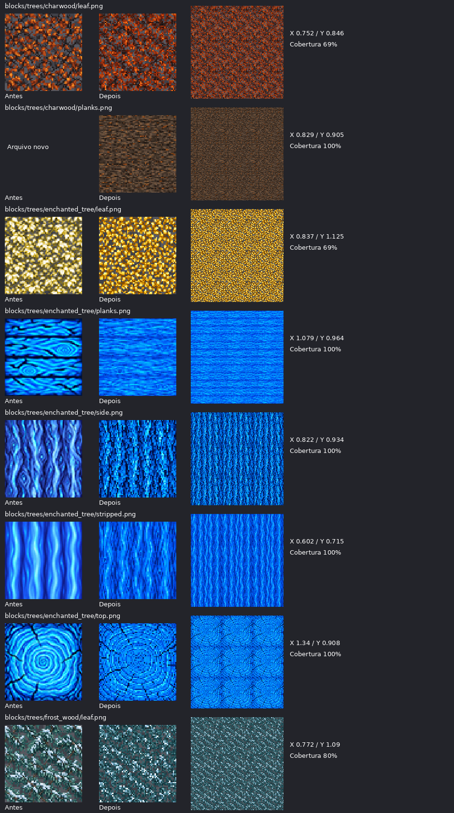
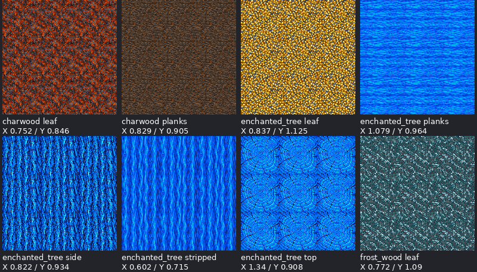
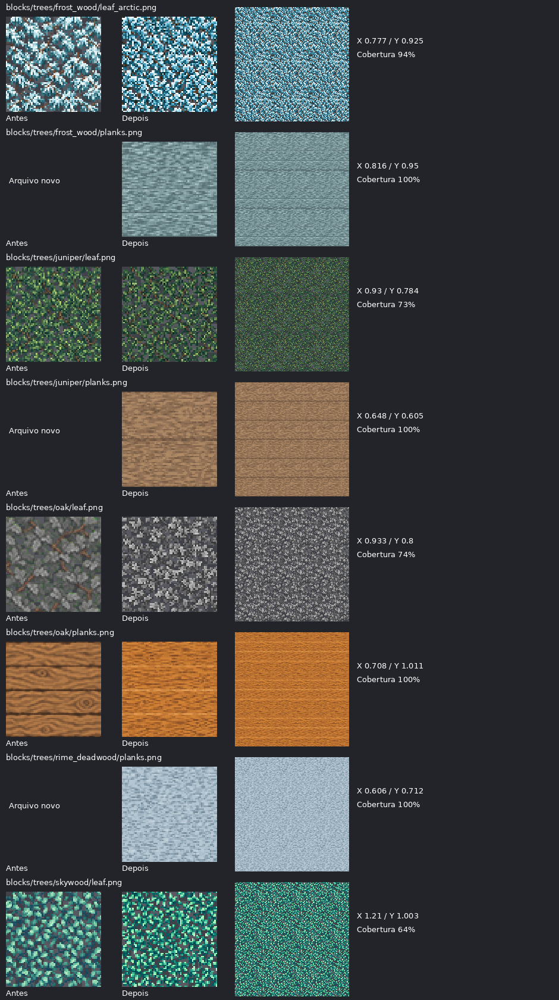
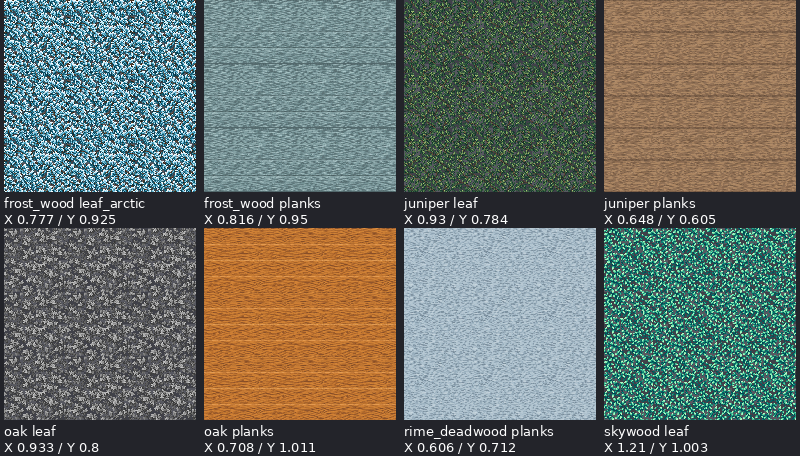
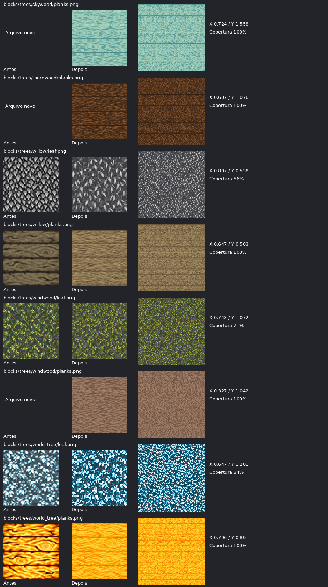
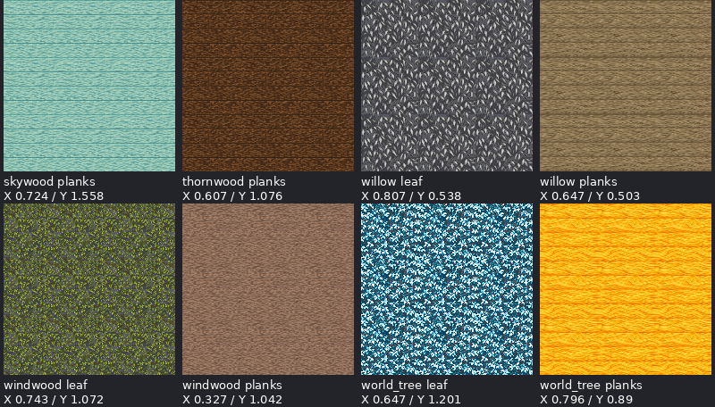
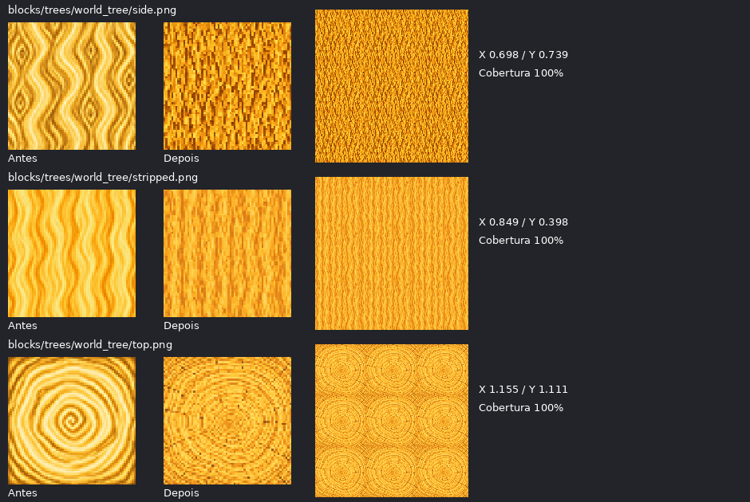
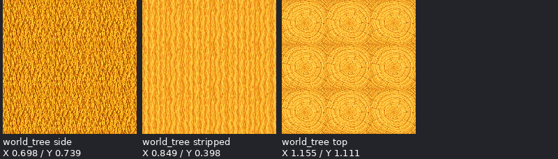

# Texturas de todas as árvores — 11/10/2026

Continuação da auditoria inicial e do PR #73. Pedido ampliado: todas as famílias de árvores existentes, planks para cada uma e revisão completa de Enchanted Tree e World Tree.

Foram criadas/refeitas **27 texturas em 64×64**: **10 folhas**, **11 planks** e **6 faces de tronco**. Das planks, sete não existiam. Os 20 arquivos existentes foram substituídos; 259 outras texturas foram preservadas por SHA256. O pack passa de 279 para 286 texturas.

## Cobertura por família

| Família | Folhas | Planks | Outras faces |
| --- | --- | --- | --- |
| `log_charwood` | refeitas | criadas | preservadas |
| `enchanted_tree` | refeitas | refeitas | top, side e stripped refeitas |
| `log_frost_wood` | refeitas (normal + arctic) | criadas | preservadas |
| `juniper` | refeitas | criadas | preservadas |
| `oak` | refeitas | refeitas | preservadas |
| `log_rime_deadwood` | slot transparente de árvore sem folhas, preservado | criadas | preservadas |
| `skywood` | refeitas | criadas | preservadas |
| `log_thornwood` | slot transparente de árvore sem folhas, preservado | criadas | preservadas |
| `willow` | refeitas | refeitas | preservadas |
| `log_windwood` | refeitas | criadas | preservadas |
| `world_tree` | refeitas | refeitas | top, side e stripped refeitas |

## Contratos e revisão

- As 27 imagens são materiais repetíveis, conferidos em mosaicos 3×3 nos dois eixos. Juntas horizontais de tábuas são parte do material. Nenhuma moldura escura foi adicionada nas bordas externas.
- Folhagens usam transparência real com alpha binário; as folhas de Oak e Willow são mapas neutros de cinza para o tint do bioma. As demais mantêm suas paletas próprias.
- Enchanted Tree conserva madeira azul royal/celeste e folhas douradas. World Tree conserva madeira dourada/âmbar e folhas claras azuladas.
- `log_rime_deadwood` e `log_thornwood` são famílias sem folhas no contrato atual; seus `leaf.png` transparentes foram preservados. Ambas receberam planks próprias.
- As sete novas planks são recursos autorizados para as famílias já existentes. Este trabalho não cria novos blocos, receitas ou referências de gameplay.
- Todos os diretórios de árvore agora têm `top`, `side`, `stripped`, `leaf` e `planks`, em 64×64. `frost_wood/leaf_arctic.png` continua como variante própria.

## Geração e normalização

Cada imagem foi criada com a ferramenta integrada `image_gen.imagegen`, com referências explícitas do pack. [prompts.json](prompts.json) registra todos os prompts e referências; [inventory.json](inventory.json) registra hashes, alpha, cobertura e métricas de borda. A normalização fez apenas redimensionamento nearest-neighbor, alpha binário e conversão para cinza nos dois mapas de tint. Não foi desenhada arte procedural por script.

A métrica de borda compara a diferença entre os pixels de bordas opostas com a diferença média entre pixels vizinhos dentro do tile, usando cor pré-multiplicada por alpha. Razões acima de 1,8 exigem revisão; todas as versões finais estão abaixo desse limiar. Essa métrica auxilia a inspeção visual e não prova continuidade geométrica de cada folha isolada.

## Verificação

- PNGs decodificáveis, dimensões, alpha, tint, presença dos cinco papéis em todas as 11 famílias, integridade dos originais e 259 hashes preservados: passaram.
- Mosaicos 3×3 e comparativos de todas as 27 texturas: revisados visualmente.
- Recursos/localizações do pack e todas as famílias de árvores: verificados pelo validador existente.
- Whitespace e ausência de metadados Godot em packs: verificados.
- Renderização dentro do jogo não foi executada neste ambiente.

## Comparativos e mosaicos

### Grupo 1

### Grupo 2

### Grupo 3

### Grupo 4

