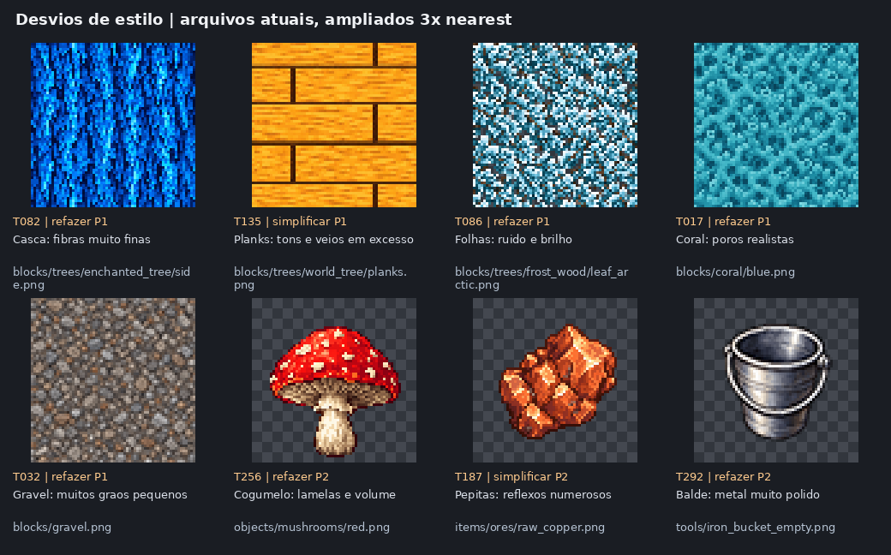

# Auditoria de estilo das texturas — 13/10/2026

O pacote atual usa muitas superfícies com fibras finas, relevo pintado, reflexos e pequenos fragmentos de cor. A aparência se aproxima de materiais realistas reduzidos e de sprites de RPG. A direção pedida é **Minecraft com resolução maior**: formas simbólicas, grupos de pixels legíveis e detalhe contido.

Fonte analisada: `36453b2276fab10819daf45e41bcf023bc55fa51` da main. Esta entrega registra a análise; os arquivos de arte e o comportamento do jogo foram preservados.

## Resultado por arquivo

| Ação | Arquivos | Significado |
| --- | ---: | --- |
| Refazer | 143 | O padrão de superfície/composição tem forte desvio de estilo; pede novo desenho. |
| Simplificar | 109 | A forma ou construção já serve; precisa de menos tons, menos detalhe ou luz mais plana. |
| Manter | 28 | Desenho compatível ou linguagem própria de UI. |
| Manter funcional | 17 | Máscara/camada simples que deve conservar seu papel de composição. |
| **Total de PNGs** | **297** | **Cada arquivo recebeu avaliação visual e recomendação.** |

As ações são uma avaliação artística relativa ao estilo pedido. “Simplificar” não equivale a “ultrarrealista”: também abrange ilustração de RPG, gradientes suaves e excesso de detalhe. Prioridades: **P1** = superfícies repetidas do mundo (127 arquivos), **P2** = sprites, ícones e efeitos (125), **P0** = manter (45).

- [Lista completa por arquivo — CSV](audit.csv): ação, prioridade, diagnóstico, correção e restrições técnicas.
- [Inventário e referências authored — JSON](audit.json): SHA-256, dimensões, alpha, cores, galeria e definições que apontam para cada arquivo.
- [Exemplos dos desvios](examples.png) e [repetição 3×3 de materiais atuais](repetition.png).
- [Direção visual para os próximos desenhos](ART_DIRECTION.md).

## Cobertura

Foram inventariados e abertos visualmente todos os **297 PNGs** de `packs/default/resources/textures`: 284 em 64×64, dez ícones em 40×40, uma skin em 256×256 e dois sprites celestes em 1254×1254. Há **293 conteúdos de arquivo distintos por SHA-256**; cópias continuam contadas por caminho porque cada referência importa.

O logo `packs/default/ui/branding/asteria_logo.svg` também foi examinado: contém uma imagem PNG 512×256 e foi marcado para manter, fora da contagem de texturas. Os **21 GLBs** do pack foram inspecionados por chunks JSON: nenhum contém entradas `images` ou `textures`. Eles usam materiais/cores e referências externas do conteúdo; não acrescentam texturas embutidas a este inventário. As imagens históricas em `docs/` não são recursos ativos e não entram na contagem.

| Categoria | Total | Refazer | Simplificar | Manter | Funcional |
| --- | ---: | ---: | ---: | ---: | ---: |
| Blocks | 140 | 75 | 59 | 4 | 2 |
| Creative categories | 10 | 0 | 0 | 10 | 0 |
| Creatures | 14 | 0 | 0 | 11 | 3 |
| Destroy stage | 10 | 0 | 0 | 0 | 10 |
| Fluids | 1 | 0 | 1 | 0 | 0 |
| Items | 27 | 15 | 12 | 0 | 0 |
| Layers | 11 | 10 | 0 | 0 | 1 |
| Objects | 68 | 38 | 30 | 0 | 0 |
| Player | 2 | 0 | 1 | 1 | 0 |
| Sky | 2 | 0 | 0 | 2 | 0 |
| Tools | 12 | 5 | 6 | 0 | 1 |

## Onde o estilo mais desviou

**Árvores: as 11 famílias precisam de ajuste.** Todas as folhas ficaram muito fragmentadas; cascas e stripped ganharam fibras e sombras finas; a maioria dos tops tem anéis demais. As 11 planks agora têm tábuas legíveis, mas seus interiores continuam cheios de veios pequenos e tons intermediários. As 11 saplings distinguem a espécie, porém parecem árvores detalhadas em miniatura.

**Materiais naturais:** cristais, corais, gravel, fossil bone, lama, parte das pedras, neve e kelp usam microtextura ou relevo pintado. Cristais e corais mostram reflexos em quase cada fragmento. Os overlays dos oito minérios precisam de depósitos maiores e separados; o padrão atual cria veios pequenos por toda a área.

**Flora e fungos:** cogumelos têm lamelas e caules anatômicos; flores e folhas usam gradientes e brilho; raízes, líquens e capins têm muitos filetes. É possível preservar a silhueta de várias plantas, mas reduzir o número de partes e a luz pintada.

**Inventário:** essências, armaduras, armas e parte das ferramentas têm acabamento de ícone de RPG. Baldes e tesoura são os exemplos mais claros de metal com brilho contínuo. Pepitas podem preservar seus grupos e paletas, com muito menos facetas e reflexos.

**Skin ativa:** `player/256.png`, referenciada por `data/entities/player.json`, usa gradientes no tecido/cabelo e pinceladas suaves. Deve manter a personagem e seu UV, com sombreado mais plano. `player/64.png` é uma boa referência de linguagem em pixels; aumentar essa imagem por nearest, sozinho, não produziria uma skin 256 desenhada com mais resolução.

**Boas referências internas:** `bricks.png` e `stone_tiles.png` têm construção clara; `glass.png` usa poucos traços grandes; `player/64.png` tem regiões simples. Rostos de slime, cracks e máscaras neutras simples não precisam ser refeitos pela mesma regra dos materiais. Sol e lua já têm regiões quadradas grandes.

## Todas as árvores e variações

Legenda: **R** = refazer, **S** = simplificar. O julgamento é por papel e por arquivo, sem excluir árvores queimadas, mortas ou fantásticas.

| Família | Leaf | Planks | Sapling | Side | Stripped | Top | Identidade a conservar |
| --- | --- | --- | --- | --- | --- | --- | --- |
| charwood | R | S | S | R | R | R | Madeira carbonizada, folhas em brasa |
| enchanted_tree | R | S | S | R | R | R | Madeira azul, folhas douradas |
| frost_wood | R + leaf_arctic R | S | S | R | R | R | Madeira e folhas frias; variante arctic própria |
| juniper | R | S | S | R | R | R | Castanho claro, conífera verde |
| oak | R | S | S | S | S | S | Madeira quente, folhas tintáveis |
| rime_deadwood | R | S | S | R | R | R | Madeira prateada/fria, folhas visíveis |
| skywood | R | S | S | R | R | R | Madeira e foliage turquesa |
| thornwood | R | S | S | R | R | R | Madeira escura, foliage cobre/bordô |
| willow | R | S | S | S | S | S | Madeira oliva, copa pendente tintável |
| windwood | R | S | S | R | R | R | Madeira neutra, foliage amarelo-esverdeada |
| world_tree | R | S | S | R | R | R | Madeira âmbar/dourada, folhas azuis |

São **67 arquivos de árvore**: 12 leaves, incluindo `leaf_arctic`, e 11 de cada um dos outros cinco papéis. Todos foram vistos. Os sete PNGs de planks sem referência authored atual também foram incluídos; a análise não cria blocks nem recipes.

## Como foi feita a revisão

O inventário foi construído a partir dos arquivos atuais e das referências string em `packs/default/data/**/*.json`. A inspeção visual usou 20 galerias com cada PNG ampliado por nearest; a skin 256 e os sprites celestes receberam inspeção adicional. O checkerboard das galerias é apenas fundo de visualização de alpha. Nas galerias de sky, o preview é reduzido; os detalhes abaixo mostram melhor seus grandes grupos de pixels.

Quantidade de cores é diagnóstico auxiliar, nunca critério automático. Por exemplo, a moon tem milhares de cores no arquivo, mas sua forma visível continua organizada em grandes pixels. O desvio foi julgado pela escala das formas, frequência do detalhe, transições de tom, luz desenhada e legibilidade do material.

O terreno já declara `filter_nearest` e `ROUGHNESS = 1.0` em `shaders/voxel_terrain_*.gdshader`. Há nearest também em materiais de player, held item e objetos unlit. Logo, alterar apenas a filtragem não resolve as fibras, reflexos e sombras que já estão pintados no albedo. Essa é uma conclusão a partir dos arquivos e shaders; o jogo não foi executado nesta auditoria.

`repetition.png` mostra quatro mosaicos atuais. É evidência da densidade e repetição do desenho, **não uma certificação de seamless de todos os assets**. O redesenho futuro deve verificar as bordas e o efeito em 3×3.

## Galerias completas

- Blocks: [1](blocks-01.png), [2](blocks-02.png), [3](blocks-03.png), [4](blocks-04.png).
- Árvores: [1](trees-01.png), [2](trees-02.png), [3](trees-03.png).
- Objects: [1](objects-01.png), [2](objects-02.png), [3](objects-03.png).
- Items: [1](items-01.png), [2](items-02.png).
- [Layers](layers-01.png), [tools](tools-01.png), [fluids](fluids-01.png).
- [Creatures](creatures-01.png), [destroy stages](destroy_stage-01.png), [creative categories](creative_categories-01.png).
- [Player](player-01.png), [detalhe da skin ativa](player-256-detail.png).
- [Sky](sky-01.png), [moon](sky-moon-detail.png), [sun](sky-sun-detail.png).
- [Branding](branding-logo.png), asset adicional de UI.

## Validação da entrega

A cobertura é exata: cada PNG atual aparece uma vez no CSV/JSON, tem um ID e uma galeria, e conserva seu SHA-256 do início da auditoria. Cada um dos 21 GLBs e o logo também tem hash registrado. Contagens e decisões duplicadas foram conferidas; nenhum arquivo de `packs/`, shader, definição ou receita foi alterado. As imagens desta pasta são composições e ampliações de diagnóstico dos assets existentes, sem geração ou substituição de arte.

Revisão de `AGENTS.md`, `ARCHITECTURE.md` e `ENGINEERING_PRACTICES.md`: alteração documental, sem novo dono de estado, API, cache, fluxo async, dependência ou lógica de runtime. A validação relevante desta entrega é a integridade do inventário e a revisão visual; a aparência final de futuros redraws deve ser validada no jogo.
