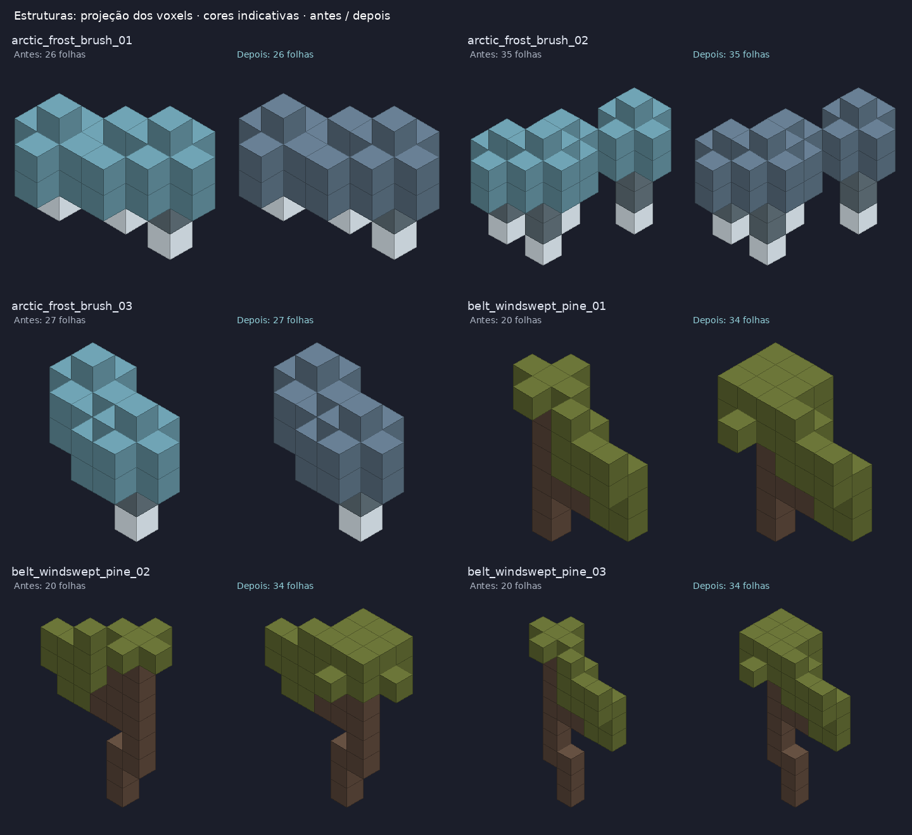
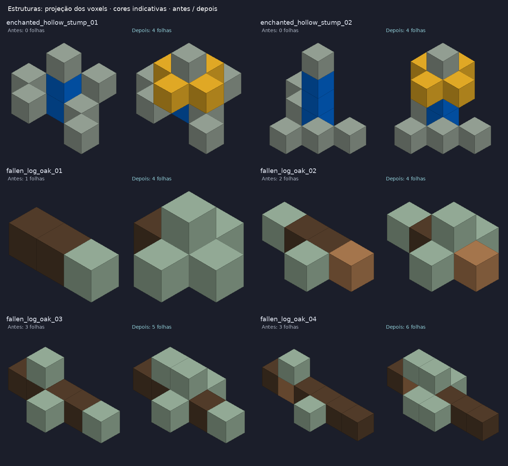
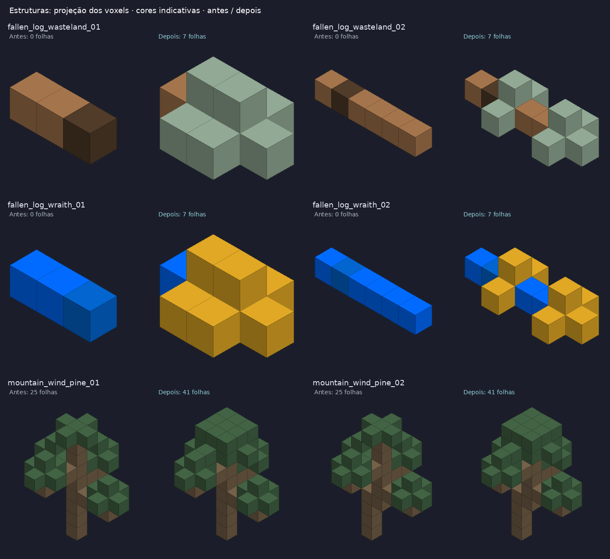
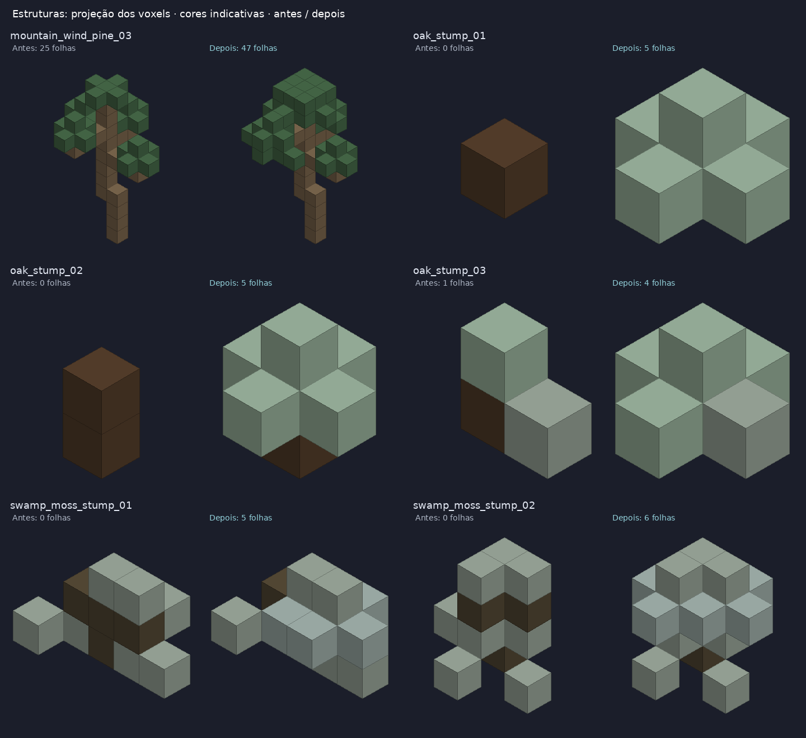
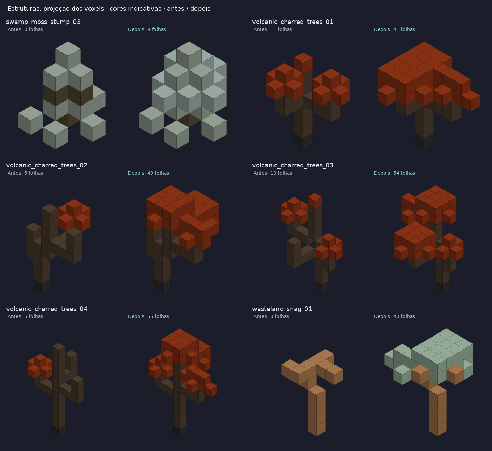
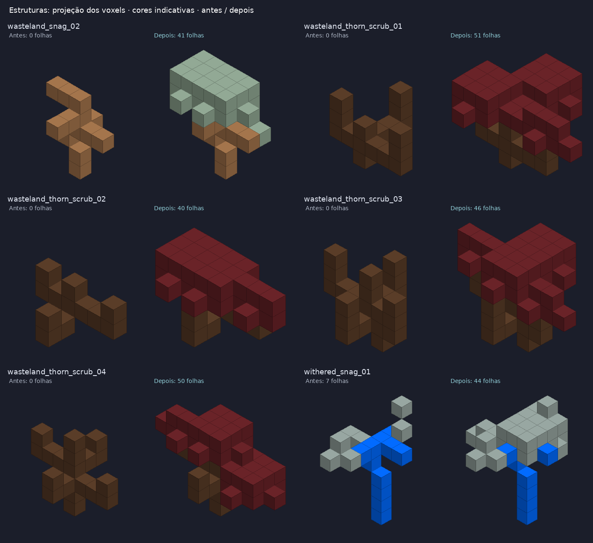
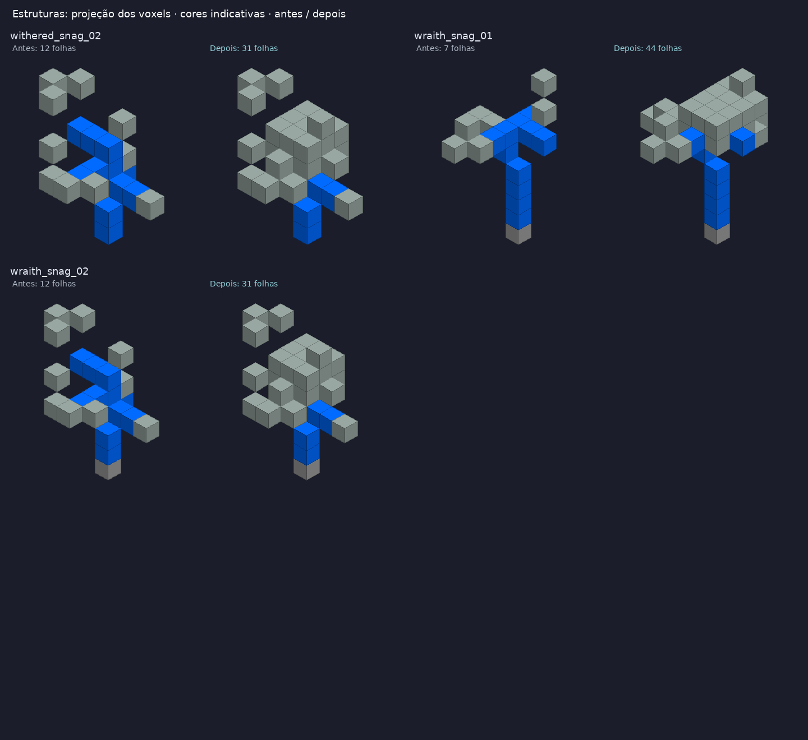

# Stripped e folhas para todas as árvores

As 11 famílias agora possuem blocos stripped cadastrados e ligados ao uso do Carpenter’s Axe. Todos os 74 templates de vegetação com madeira possuem voxels de folhas; 39 templates foram ajustados. Árvores queimadas, mortas, congeladas e espectrais mantêm copas por decisão explícita de fantasia. Tocos e troncos caídos mantêm brotos.

Foram adicionados 7 blocos stripped e 2 blocos de folhas, com nomes em português brasileiro, inglês e espanhol. As variantes natural/stripped das 11 famílias estão ligadas por `variant.family` e `variant.key`, em X/Y/Z. Willow, Enchanted e World Tree também tiveram seus pares hollow existentes ligados à família e com geometria hollow explícita, usando o mesmo contrato já existente de Oak. Nenhum comportamento é inferido do nome do bloco.

| Família | Natural | Stripped |
| --- | --- | --- |
| charwood | `asteria:log_charwood` | `asteria:log_charwood_stripped` |
| enchanted_tree | `asteria:log_enchanted_tree` | `asteria:log_enchanted_tree_stripped` |
| frost_wood | `asteria:log_frost_wood` | `asteria:log_frost_wood_stripped` |
| juniper | `asteria:log_juniper` | `asteria:log_juniper_stripped` |
| oak | `asteria:log_oak` | `asteria:log_oak_stripped` |
| rime_deadwood | `asteria:log_rime_deadwood` | `asteria:log_rime_deadwood_stripped` |
| skywood | `asteria:log_skywood` | `asteria:log_skywood_stripped` |
| thornwood | `asteria:log_thornwood` | `asteria:log_thornwood_stripped` |
| willow | `asteria:log_willow` | `asteria:log_willow_stripped` |
| windwood | `asteria:log_windwood` | `asteria:log_windwood_stripped` |
| world_tree | `asteria:log_world_tree` | `asteria:log_world_tree_stripped` |

As 2 texturas de folhas foram criadas com o modo **built-in `image_gen.imagegen`**, usando folhas e madeira existentes como referências de estilo. Arquivos finais:

- `packs/default/resources/textures/blocks/trees/rime_deadwood/leaf.png`
- `packs/default/resources/textures/blocks/trees/thornwood/leaf.png`

As duas são PNG RGBA em 64×64, com alpha 0/255 e repetição seamless nos dois eixos. Os mosaicos 3×3 foram inspecionados visualmente. As outras 284 texturas do pack foram preservadas byte a byte.

[Prompts e referências com SHA-256](prompts.json) · [Mosaicos 3×3](leaves-seam-proof.png) · [Validação e inventário completo dos 74 templates](validation.json)

| Template ajustado | Folhas antes | Folhas depois |
| --- | ---: | ---: |
| `brush_frost_arctic_01` | 26 | 26 |
| `brush_frost_arctic_02` | 35 | 35 |
| `brush_frost_arctic_03` | 27 | 27 |
| `tree_pine_belt_windswept_01` | 20 | 34 |
| `tree_pine_belt_windswept_02` | 20 | 34 |
| `tree_pine_belt_windswept_03` | 20 | 34 |
| `stump_enchanted_tree_hollow_01` | 0 | 4 |
| `stump_enchanted_tree_hollow_02` | 0 | 4 |
| `log_oak_fallen_01` | 1 | 4 |
| `log_oak_fallen_02` | 2 | 4 |
| `log_oak_fallen_03` | 3 | 5 |
| `log_oak_fallen_04` | 3 | 6 |
| `log_wasteland_fallen_01` | 0 | 7 |
| `log_wasteland_fallen_02` | 0 | 7 |
| `log_wraith_fallen_01` | 0 | 7 |
| `log_wraith_fallen_02` | 0 | 7 |
| `tree_pine_mountain_wind_01` | 25 | 41 |
| `tree_pine_mountain_wind_02` | 25 | 41 |
| `tree_pine_mountain_wind_03` | 25 | 47 |
| `stump_oak_01` | 0 | 5 |
| `stump_oak_02` | 0 | 5 |
| `stump_oak_03` | 1 | 4 |
| `stump_swamp_moss_01` | 0 | 5 |
| `stump_swamp_moss_02` | 0 | 6 |
| `stump_swamp_moss_03` | 0 | 9 |
| `tree_charred_volcanic_01` | 11 | 41 |
| `tree_charred_volcanic_02` | 5 | 49 |
| `tree_charred_volcanic_03` | 10 | 54 |
| `tree_charred_volcanic_04` | 5 | 55 |
| `snag_wasteland_01` | 0 | 40 |
| `snag_wasteland_02` | 0 | 41 |
| `scrub_thorn_wasteland_01` | 0 | 51 |
| `scrub_thorn_wasteland_02` | 0 | 40 |
| `scrub_thorn_wasteland_03` | 0 | 46 |
| `scrub_thorn_wasteland_04` | 0 | 50 |
| `snag_withered_01` | 7 | 44 |
| `snag_withered_02` | 12 | 31 |
| `snag_wraith_01` | 7 | 44 |
| `snag_wraith_02` | 12 | 31 |

As projeções abaixo mostram os voxels exatos antes/depois, com cores indicativas. São revisão de geometria, sem iluminação ou materiais do jogo.

Validação local: referências de recursos e localização; 11 famílias com folhas visíveis e stripped em X/Y/Z; payloads originais de terreno, troncos e detalhes preservados; novas folhas conectadas por faces à madeira; nenhum voxel novo abaixo de Y=1. Testes de Core acrescentados para o uso real do machado com os arquivos authored e para a presença de folhas em todos os templates de vegetação. .NET e Godot não estão disponíveis neste ambiente; execução dos testes de Core ocorre na CI. Não houve captura dentro do jogo.

Referência consultada: `sarakborges/mineclone`, branch `world-systems-rebuild`, commit `e8bc8562abc22eb4a54561c1e7afe8cc086e3dd9`: `src/tools/carpenters_axe.rs`, `src/voxel/log_variant.rs`, `data/blocks/log_oak.json` e `data/structures/tree_oak/01.json`. Asteria reutiliza seu registro declarativo de variantes e seu runtime de mutação; não porta a descoberta por prefixo/sufixo de IDs.

Base Asteria: `ee33268a2d19f7101927b66b2770edfa24919677`.
