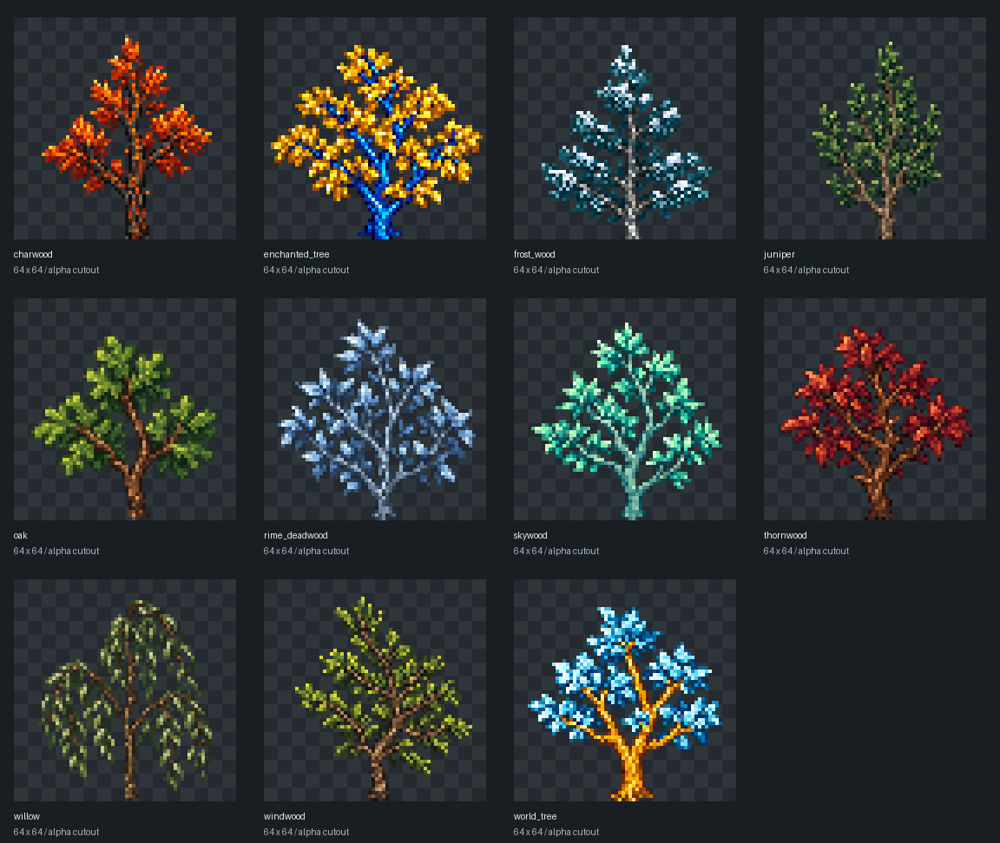

# Saplings de todas as famílias

11 mudas cobrem todas as pastas de árvores do pack, inclusive as famílias carbonizada, congelada, Enchanted e World Tree.

| Família | Bloco | Textura final no pack |
| --- | --- | --- |
| Charwood | `asteria:sapling_charwood` | `textures/blocks/trees/charwood/sapling.png` |
| Enchanted Tree | `asteria:sapling_enchanted_tree` | `textures/blocks/trees/enchanted_tree/sapling.png` |
| Frost Wood | `asteria:sapling_frost_wood` | `textures/blocks/trees/frost_wood/sapling.png` |
| Juniper | `asteria:sapling_juniper` | `textures/blocks/trees/juniper/sapling.png` |
| Oak | `asteria:sapling_oak` | `textures/blocks/trees/oak/sapling.png` |
| Rime Deadwood | `asteria:sapling_rime_deadwood` | `textures/blocks/trees/rime_deadwood/sapling.png` |
| Skywood | `asteria:sapling_skywood` | `textures/blocks/trees/skywood/sapling.png` |
| Thornwood | `asteria:sapling_thornwood` | `textures/blocks/trees/thornwood/sapling.png` |
| Willow | `asteria:sapling_willow` | `textures/blocks/trees/willow/sapling.png` |
| Windwood | `asteria:sapling_windwood` | `textures/blocks/trees/windwood/sapling.png` |
| World Tree | `asteria:sapling_world_tree` | `textures/blocks/trees/world_tree/sapling.png` |

Os caminhos da tabela são relativos a `packs/default/resources/`. Cada PNG tem 64×64 pixels, fundo transparente e recorte por alpha. Mudas são sprites isolados; as texturas de superfície seamless existentes permanecem preservadas.

Cada silhueta é própria da espécie. Enchanted conserva tronco azul com folhas douradas; World Tree conserva tronco dourado com folhas azuis. Oak e Willow recebem verdes naturais no sprite, sem aplicar tinta de bioma ao tronco. Famílias queimadas, mortas e congeladas continuam com folhas, seguindo a direção de fantasia solicitada.

## Integração

As mudas aparecem na categoria de folhagens do inventário criativo, com nomes em português brasileiro, inglês e espanhol. Usam o `crossedSprite` existente com quatro planos, sem colisão, vento e alpha cutoff 0.5. Só podem ser colocadas pela face superior e requerem suporte sólido abaixo. Quebrar a muda ou remover seu suporte recupera a mesma muda, que pode ser replantada.

O registro de blocos, o catálogo de inventário, a colocação, os drops e a física existentes continuam como os donos dessas capacidades. Nenhum comportamento depende de IDs especiais no código. Este trabalho cria os recursos e os blocos plantáveis; crescimento automático e loot de mudas ao quebrar folhas ainda não fazem parte do runtime.

## Arte e verificação

Foi usado o **ImageGen embutido**, em uma chamada por muda, com o sprite de Thornbush como referência de estilo e as folhas e a casca da família como referências de materiais. A normalização usa nearest-neighbor, o recorte alpha do jogo e alinhamento da base pelo espaço transparente, para que a raiz toque o chão. Não há desenho procedural nem corte de pixels visíveis. Os prompts exatos, referências com SHA-256 e hashes dos resultados estão em [prompts.json](prompts.json).

[validation.json](validation.json) registra cobertura das famílias, PNGs distintos, dimensões, transparência e enquadramento. O preview acima reúne os arquivos finais; não é uma captura do jogo.

`TreeSaplingContentTests` testa as onze mudas no catálogo e no runtime real: suporte obrigatório, rejeição de faces laterais/inferiores, colocação sem bloquear o jogador, quebra, replantio e recuperação após remoção do suporte. A validação de WebUI verifica as texturas e as três traduções. A CI executa os testes de Core, build, benchmark de worldgen, WebUI, Storybook e screen parity. O ambiente local não possui .NET/Godot; a execução do jogo não foi capturada aqui.

Referência dos materiais: `8dfc12455dfe68936f93cc31def793f78c737ace`. A integração acompanha a main mais recente, incluindo o catálogo e o runtime de loot.
